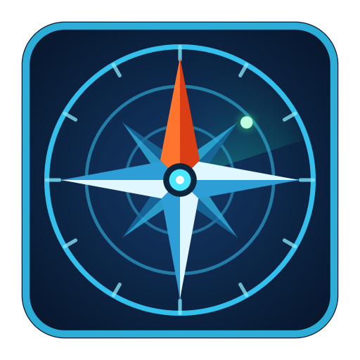

#  NMEA Studio

A cross-platform **NMEA 0183 & NMEA 2000** simulator, traffic analyzer, and test studio inspired by **NemaStudio**, built natively in Rust with `eframe` / `egui` for **macOS, Linux, and Windows**.

📖 **Documentation & User Guide**:
- **[Complete User Manual — `USER_MANUAL.md`](USER_MANUAL.md)**

---

## Key Features

### 1. Default Empty Project, Presets & Interactive File Browser
- **Unconfigured Default Startup**: Starts on a clean, empty project (`0. Empty Project (Unconfigured Default)`) so you can build your exact topology from scratch.
- **Built-in Scenarios**: Quickly load pre-configured vessel setups (`1. Coastal Cruiser`, `2. High-Speed Patrol Craft`, `3. Harbor Tug & Engine Test`) from the top toolbar.
- **Save & Load Modal Dialog (`💾 Save...` / `📂 Load...`)**: Interactive directory browser and file picker to save or load `.json` project presets anywhere on disk.

### 2. Modular Device Simulator (NMEA 0183 Default + NMEA 2000)
Add individual marine equipment on demand from the left **Object Explorer** or the **📡 Instruments** tab:
- `🌐 GPS / GNSS Receiver` (`GGA`, `RMC`, `GLL`, `VTG`, `GSA`, `GSV`, `ZDA` / PGNs `126992`, `129025`, `129026`, `129029`)
- `🎯 Gyro / Heading & Attitude` (`HDT`, `HDG`, `HDM`, `ROT` / PGNs `127250`, `127251`, `127257`, `127258`)
- `💨 Wind & Weather Sensor` (`MWV`, `MWD`, `VWR`, `VWT`, `MDA`, `XDR` / PGNs `130306`, `130310`, `130311`, `130312`, `130314`)
- `🌊 Depth Sounder & Speed Log` (`DPT`, `DBT`, `DBS`, `DBK`, `MTW`, `VHW`, `VLW` / PGNs `128259`, `128267`, `128275`)
- `☸ Autopilot & Route Navigation` (`APB`, `RMB`, `BOD`, `BWC`, `XTE`, `WPL`, `RTE` / PGNs `129283`, `129284`)
- `⚙ Engine, Rudder & Tanks` (`RSA`, `RPM`, `XDR` / PGNs `127245`, `127488`, `127489`, `127505`, `127508`)
- `🛠 Custom Empty Instrument`
- `🚢 AIS Transponder & Target (!AIVDM / !AIVDO)` & `📡 ARPA Radar Target ($RATTM)`

By default, newly added instruments are configured in **NMEA 0183 Only** mode (`ProtocolMode::Nmea0183Only`) and can be switched per device to **NMEA 2000 (PGNs)** or **Dual (NMEA 0183 + NMEA 2000)**.

### 3. Per-Device Port Routing & IEC 61162-450 Multicast Standards
Each instrument and the AIS/ARPA simulator includes an **Output Port Routing** bar to bind specific ports or one-click create:
- `🔌 Serial Port` (`COM*`, `/dev/tty*`, `/dev/cu.*`, `4800` to `230400` bps)
- `📡 UDP Unicast` (`127.0.0.1:10110` or custom IP:Port)
- `🌐 UDP Multicast` with automatic **IEC 61162-450 (OneNet / LWE)** standard multicast group assignment by device type:

| IEC 61162-450 Group | Multicast IP | UDP Port | Typical Marine Equipment |
| :--- | :--- | :--- | :--- |
| **MISC** | `239.192.0.1` | `60001` | Miscellaneous / Custom Equipment |
| **TGTD** | `239.192.0.2` | `60002` | AIS Transponder (`!AIVDM`/`!AIVDO`) & Radar ARPA (`$RATTM`) |
| **SATD** | `239.192.0.3` | `60003` | Echo Sounder, Depth & Speed Log (`DPT`, `DBT`, `VHW`) |
| **NAVD** | `239.192.0.4` | `60004` | GNSS/GPS, Gyrocompass, Wind & Weather, Autopilot |
| **VDRD** | `239.192.0.5` | `60005` | Voyage Data Recorder (VDR) |
| **RCOM** | `239.192.0.6` | `60006` | Radiocommunication |
| **TIME** | `239.192.0.7` | `60007` | Time & Frequency (`ZDA`) |
| **PROP** | `239.192.0.8` | `60008` | Propulsion, Engine, Rudder & Tanks (`RPM`, `RSA`, `XDR`) |

Also supports **UDP Broadcast**, **TCP Server**, and **TCP Client** connections.

### 4. Simulated Vessel, Helm & High-Contrast Gauges
- **System-Linked Day / Night High-Contrast UI**: Automatically follows the OS light/dark appearance (`ThemePreference::System`) with high-contrast sunlight-readable Day colors and glare-free Night colors.
- **Interactive Graphical Gauges** (with dedicated readout strip below each dial so text never overlaps graphics):
  - **360° Compass & Course Rose**: Drag inside the dial to steer `HDG` & `COG`.
  - **360° Wind Anemometer Rose**: Bow-up wind rose displaying Apparent Wind (`AWA`/`AWS`) and True Wind (`TWA`/`TWS`), with drag-to-adjust wind angle.
  - **Echo Sounder Bathymetry & Artificial Horizon / Rudder Strip**: Live depth history, pitch/roll horizon, and rudder bar.
- **Interactive 2D Nautical Chart & Radar Plotter**: Pan/zoom chart with range rings, graticule grid, waypoint route editor, **Route Autopilot** (`XTE` steering), and AIS/ARPA target vectors with CPA/TCPA alarms.

### 5. Split Resizable Traffic Console & Linked Packet Decoder
- **Independently Resizable Panels**: Resize the bottom dock vertically and drag the vertical splitter between the **📡 Traffic Stream** (left) and the **🔬 Packet Decoder** (right).
- **Direct Visual Link (`#Seq`)**:
  - In **Live Follow** mode (`◎ LIVE FOLLOW #00012`), the latest matching frame is highlighted (`▶ #0012`) and decoded in real time.
  - Click any frame in the Traffic Stream to **Pin** it (`📌 PINNED #00012` / `📌#0012`) and inspect its exact timestamp, direction (`TX`/`RX`), source port, raw payload, checksum status, and engineering fields while traffic continues flowing. Click `▶ Follow Live` (or click the pinned row again) to resume live tracking.

---

## Building, Testing & Running

```bash
# Run all unit and headless UI tests
cargo test

# Run the desktop application (Debug)
cargo run

# Build optimized release binary (macOS, Linux, Windows)
cargo build --release

# Build native macOS "NMEA Studio.app" bundle (launches from Finder with no Terminal window)
./scripts/bundle-macos-app.sh
```

### Cross-Platform GUI Packaging (No Terminal / Console Window)
- **Windows (`x86_64-pc-windows-msvc`)**: Compiled with `#![cfg_attr(not(test), windows_subsystem = "windows")]` so launching `NMEA Studio.exe` opens the GUI directly with no console prompt.
- **macOS (`aarch64-apple-darwin` & `x86_64-apple-darwin`)**: Packaged and ad-hoc signed (`codesign --force --deep --sign -`) as a native **`NMEA Studio.app`** bundle and **`.dmg`** disk image so Finder launches it as a native macOS app without opening `Terminal.app`.
  - *Note on macOS Gatekeeper quarantine*: Because GitHub Actions builds use ad-hoc signing rather than a paid Apple Developer ID certificate, macOS Gatekeeper may flag a browser-downloaded `.app` with a quarantine attribute. Clear it once after downloading by running:
    ```bash
    xattr -cr "NMEA Studio.app"
    ```
- **Linux (`x86_64-unknown-linux-gnu`)**: Packaged as a `.tar.gz` archive including a FreeDesktop `nmea-studio.desktop` entry (`Terminal=false`).
- **GitHub Actions CI/CD**: Automated workflows in `.github/workflows/ci.yml` and `.github/workflows/release.yml` test and build GUI bundles for all platforms on every push, pull request, or `v*` tag.

---

## Project Architecture

```text
src/
├── main.rs              # Application entrypoint & native window configuration
├── lib.rs               # Crate modules export
├── model/
│   ├── mod.rs           # StudioProject, presets (Empty default + 3 scenarios), JSON persistence
│   ├── vessel.rs        # VesselState, kinematics, wave & sensor fluctuation engine
│   ├── instruments.rs   # Instrument templates, NMEA 0183 sentences, NMEA 2000 PGNs, fault injection
│   ├── ais.rs           # AIS Class A/B & Radar ARPA targets, CPA/TCPA collision math
│   └── route.rs         # Waypoints, legs, Great-Circle/Rhumb-Line navigation, Route Autopilot
├── protocols/
│   ├── nmea0183.rs      # NMEA 0183 encoders, ITU-R M.1371 6-bit AIS VDM/VDO armoring, XOR checksum
│   ├── nmea2000.rs      # NMEA 2000 PGN binary encoders, Fast-Packet framing, YD RAW / $PCDIN / Actisense
│   └── inspector.rs     # Live packet decoder & dissector for NMEA 0183, AIS VDM/VDO, and NMEA 2000 PGNs
├── recorder/
│   └── mod.rs           # Stream log recorder (.log/.nmea) and variable-rate log replayer
├── transport/
│   └── mod.rs           # Multi-threaded Serial, UDP Unicast/Multicast (IEC 61162-450)/Broadcast, TCP Server/Client
└── ui/
    ├── mod.rs           # Main studio layout, high-contrast theme, Explorer, Tabs, Split Traffic & Decoder
    ├── gauges.rs        # 360° Compass, Wind Anemometer Rose, Bathymetry & Horizon gauges
    └── plotter.rs       # 2D Nautical Chart & Radar ARPA overlay with interactive route editing
```
